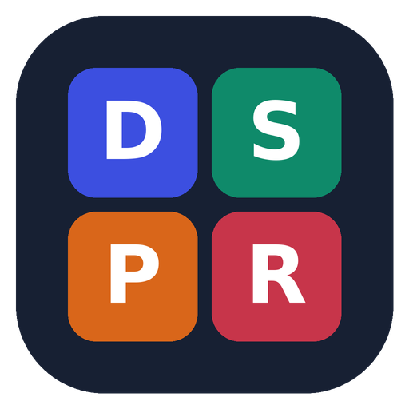
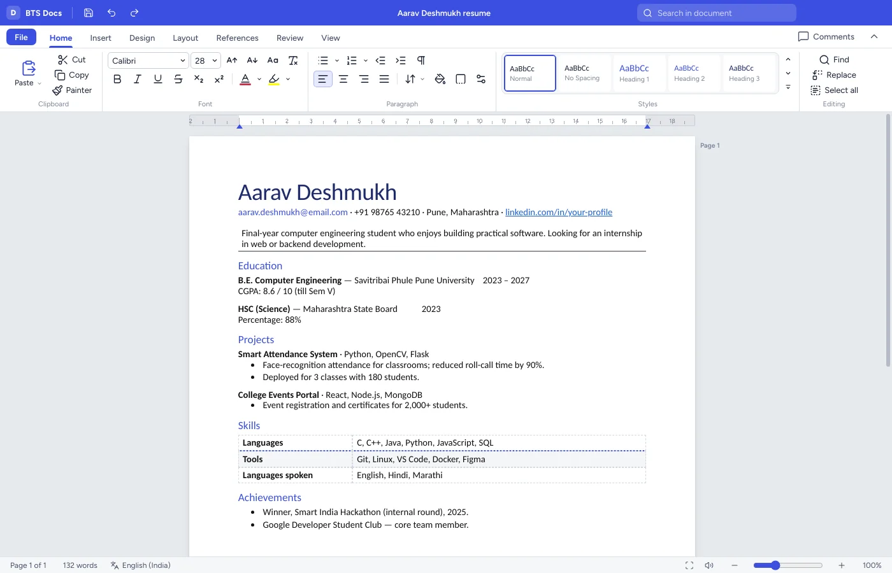

<p align="center"></p>
<h1 align="center">BTS Office</h1>
<p align="center">A free, open-source office suite for students: documents, spreadsheets, presentations and PDFs.<br>
<a href="https://office.btspl.tech"><b>Download</b></a> · <a href="https://office.btspl.tech/#faq">Help</a> · <a href="CONTRIBUTING.md">Contribute</a></p>

<p align="center">
<a href="../../actions/workflows/ci.yml"></a>
<a href="../../releases/latest"></a>
<a href="LICENSE"></a>
</p>



| App | Opens | Saves |
|---|---|---|
| **BTS Docs**, a word processor | .docx, .odt, .html, .md, .txt, .rtf | .docx, .html, .md, .txt, PDF |
| **BTS Sheets**, a spreadsheet | .xlsx, .xls, .ods, .csv, .tsv | .xlsx, .csv, .ods, .html, PDF |
| **BTS Slides**, for presentations | .pptx | .pptx, PDF |
| **BTS PDF**, a reader and annotator | .pdf | annotated .pdf |

## Features

- **Docs:** ribbon with Home, Insert, Design, Layout, References, Review and View. Real A4/Letter pages, styles, lists, tables with merged cells, pictures with text wrap, headers and footers with page numbers, table of contents, footnotes, comments, watermark, find and replace, word count, read aloud, spell check and crash recovery.
- **Sheets:** 400+ Excel-compatible formulas, fill handle, freeze panes, merge, ₹ number formats, conditional formatting, tables, sort and filter, data validation, charts, named ranges, multiple sheets and full undo.
- **Slides:** 11 themes, layouts, shapes, pictures, tables, charts and icons. Transitions, animations, a full-screen slide show with pen and laser pointer, slide sorter and notes.
- **PDF:** thumbnails, bookmarks, search, zoom and rotate. Highlight, draw and add notes, then save them into the PDF.
- **Everywhere:** student templates, light and dark themes, recent files, drag-and-drop, familiar shortcuts, and **automatic updates**.

## Install

Download the installer from **https://office.btspl.tech** and run it. The installer isn't code-signed yet, so Windows may say "Windows protected your PC". Click **More info → Run anyway**.

BTS Office then keeps itself up to date: it checks `https://office.btspl.tech/updates/latest.yml`, downloads new versions in the background and installs them when you close it. See **File → Options & about** to check manually or turn automatic updates off.

## Build from source

Requirements: Node.js 20+.

```bash
npm install
npm start                 # run the app
npm run dist:win          # Windows installer → dist/
npm run dist:linux        # AppImage + .deb
```

Building the Windows installer on Linux needs Wine. On Windows it builds natively.

## Publishing updates

1. Bump `version` in `package.json` and add release notes to the top of `website/releases.json`.
2. Push a tag such as `v1.2.0`. GitHub Actions builds the installer, creates a GitHub Release and uploads the website and update feed to office.btspl.tech.

Details: [docs/RELEASING.md](docs/RELEASING.md) · hosting on Hostinger: [docs/HOSTING.md](docs/HOSTING.md).

## Project layout

```
main.js, preload.js, updater.js   Electron main process, secure bridge, auto-updater
app/                              the four apps + start screen (plain HTML/CSS/JS, no bundler)
app/common/                       shared shell: title bar, ribbon, File view, dialogs, updates UI
website/                          office.btspl.tech download page + update feed config
tools/                            release, site assembly, FTP deploy, screenshot test harness
docs/                             architecture, releasing, hosting
```

Start with [docs/ARCHITECTURE.md](docs/ARCHITECTURE.md) before changing code.

## License

GPL-3.0-or-later. See [LICENSE](LICENSE). Third-party components keep their own licenses: Electron (MIT), electron-updater (MIT), HyperFormula (GPL-3.0), ExcelJS (MIT), SheetJS Community (Apache-2.0), docx (MIT), Mammoth (BSD-2), PptxGenJS (MIT), JSZip (MIT/GPL-3.0), PDF.js (Apache-2.0), pdf-lib (MIT), Chart.js (MIT), Lucide icons (ISC), and Figtree and the bundled slide fonts (SIL OFL 1.1).

**Developer:** Bhoomiputra Tech Solutions Private Limited ([btspl.tech](https://btspl.tech)).

BTS Office is an independent project. It is not affiliated with Microsoft or The Document Foundation; product names belong to their owners.
